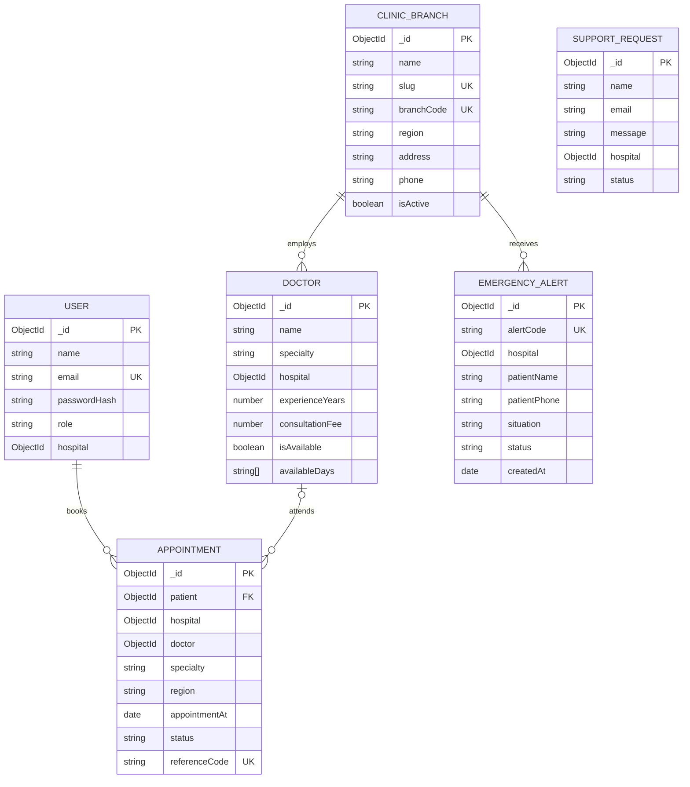

# CareSlot MongoDB schema

CareSlot uses two MongoDB databases owned by separate services. References between the databases are ObjectId values exchanged over REST; MongoDB `populate` is intentionally not used across service boundaries. Mongoose adds `createdAt` and `updatedAt` timestamps.

## Entity relationships

## Service databases and collections

| Collection | Main fields | Important rules |
| --- | --- | --- |
| Appointment service `users` | name, email, phone, passwordHash, role, hospital | Unique normalized email; role is `patient`, `staff`, or `admin`; password hash excluded from normal queries. Staff `hospital` value is an ID from the directory service. |
| Appointment service `appointments` | patient, patientName, patientEmail, patientPhone, hospital, doctor, specialty, region, appointmentAt, reason, status, referenceCode | Patient, branch, date, status, and reference indexed; reference code unique. `hospital` and `doctor` IDs refer to directory records. |
| Appointment service `emergencyalerts` | alertCode, patientName, patientPhone, hospital, hospitalName, region, situation, status, priority | A public alert is routed to one selected directory branch and appears in that branch’s staff dashboard. Alerts have `new`, `acknowledged`, and `resolved` states. |
| Appointment service `supportrequests` | name, email, message, hospital, status | Support messages are limited to 1,200 characters; optional branch ID. |
| Directory service `hospitals` | name, slug, branchCode, region, locality, address, phone, emergencyPhone, services, imageUrl, isActive | Unique slug and branchCode; region indexed and restricted to supported Tamil Nadu regions. |
| Directory service `doctors` | name, specialty, hospital, qualifications, experienceYears, imageUrl, consultationFee, availableDays, isAvailable, isActive | Branch and specialty indexed; doctor is searchable by branch/specialty/day. |

Appointment statuses: `requested` → `confirmed` → `completed`, or `cancelled`.

## Data flow

1. A patient signs in and receives a JWT; `users` stores only a bcrypt password hash.
2. The browser loads active branches and available doctors from the Clinic Directory Service.
3. The Appointment Service validates branch, specialty, doctor and weekday availability through authenticated REST calls to the directory service.
4. The server creates an `appointments` record and returns its reference code. Staff can query the queue for their assigned branch and update status.
5. A visitor can submit a short emergency alert for a chosen branch. The Appointment Service verifies the branch over REST, stores the alert, and staff dashboards poll for new alerts every 10 seconds. Desktop browser notifications are optional and require staff permission.

Emergency alerts are in-app notices only; they do not contact ambulance dispatch, send an SMS/email, or call emergency services. Continue to call 112 for an immediate emergency. Do not put full medical records or payment data in this database. Configure Atlas access controls and a short retention policy before production use.
